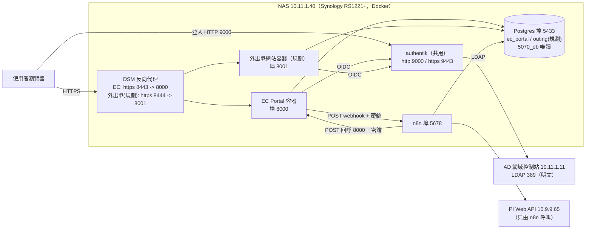

# 架構圖與資料夾位置

離開 session 後，用這份找「東西在哪裡」。設計理由看 `01-architecture.md`，新增功能看 `05-add-feature-guide.md`。
（2026-11 整理。標「規劃」的是還不存在、依 `05` 預計建立的位置。）

**關於範例**：目前實際在跑的只有 EC Portal（EC 查詢）。文件裡的「**外出單（outing）**」是**範例**，用來示範「再新增第二個獨立網站」會多出哪些資料夾、連接埠、資料庫與 authentik 設定，現在並不存在。
實際要做的新功能請把 `outing` 換成自己的功能名稱（例如 `outing-web` 換成 `<功能>-web`、埠 8001／8444 換成沒人用的埠、資料庫 `outing` 換成 `<功能>`）。換法與完整步驟見 `05-add-feature-guide.md`。

## 1. 整體架構



純文字版（工具不支援 mermaid 時看這個）：

```
使用者瀏覽器
  |-- https://10.11.1.40:8443 --> DSM 反向代理 --> EC Portal 容器 (8000)
  |-- https://10.11.1.40:8444 --> DSM 反向代理 --> 外出單容器 (8001)   [規劃]
  `-- http://10.11.1.40:9000  --> authentik（登入畫面；網站透過 OIDC 對它）

authentik --LDAP 389--> AD 10.11.1.11（帳密驗證、使用者同步）

EC Portal --POST（X-EC-Secret）--> n8n :5678 webhook ec-portal-query
n8n --POST 回呼（X-EC-Secret）--> http://10.11.1.40:8000/api/internal/jobs/<id>/status
n8n --> PI Web API 10.9.9.65（查歷史資料）--> 寄 Excel 到信箱

各網站 --> NAS Postgres :5433（各自的資料庫；5070_db 只讀）
```

## 2. 資料夾位置

### 2.1 開發電腦（Windows）

| 內容 | 位置 |
|---|---|
| **EC Portal 專案（git repo）** | `C:\Users\EID\Documents\Claude\ShuHsing\ec-portal\`（GitHub：`shinu0750/ec-portal`，private） |
| 專案簡報與決策表 | `ec-portal\CLAUDE.md`（與 `docs\00-project-brief.md` 同步） |
| 規劃文件 | `ec-portal\docs\`：`01-architecture.md`、`02-work-plan.md`、`03-human-checklist.md`、`05-add-feature-guide.md`、本檔 |
| 部署清單 | `ec-portal\docs\deploy\`：`authentik-deploy.md`、`authentik-ad.md`、`portal-deploy.md` |
| 測試與實測紀錄 | `ec-portal\docs\`：`e2e-results.md`、`c2-results.md`、`authentik-notes.md`、`n8n-inventory.md`、`c1-notes.md` |
| 網站程式 | `ec-portal\app\`（`auth\`、`features\ec_query\`、`jobs\`、`templates\`、`static\`） |
| 資料庫遷移 | `ec-portal\migrations\` |
| 網站部署檔（NAS 用） | `ec-portal\deploy\portal\`：`docker-compose.nas.yml`、`nas.env.example`、`make-nas-bundle.ps1` |
| authentik 部署檔 | `ec-portal\deploy\authentik\`：`docker-compose.nas.yml`、`.env.example`、`blueprints\ec-portal.yaml`、`blueprints\ad-source.yaml` |
| n8n 備份與匯出 | `ec-portal\n8n\backups\`（原始 workflow 備份）、`ec-portal\n8n\ec-query-fixed.json`、`ec-portal\n8n\ec-export-multi.json` |
| 本機密鑰（不進 git） | `ec-portal\.env`、`ec-portal\.mcp.json` |
| 打包產物 | 執行 `make-nas-bundle.ps1` 的資料夾下的 `ec-portal-nas-bundle.tar.gz` |
| n8n 連線設定來源 | `C:\Users\EID\Documents\Claude\ShuHsing\Hermes agent\`（`.mcp.json`、`.env`） |
| 本機開發用 Docker | 只在 WSL 的 Ubuntu 裡（`wsl -d Ubuntu -- docker ...`），Windows 端沒有 `docker` 指令 |
| **新網站專案（規劃）** | `C:\Users\EID\Documents\Claude\ShuHsing\outing-portal\`（複製 `ec-portal` 後改名，新 git repo） |

### 2.2 NAS（`10.11.1.40`，Docker 一律用 `sudo docker compose -f docker-compose.nas.yml ...`）

| 內容 | 位置 |
|---|---|
| **authentik** | `/volume1/docker/ec-portal-authentik/`：`docker-compose.nas.yml`、`.env`（密碼與密鑰，`chmod 600`）、`blueprints/`、`data/`、`certs/`、`custom-templates/` |
| **EC Portal 網站** | `/volume1/docker/ec-portal-web/`（解壓的原始碼）；設定檔在 `/volume1/docker/ec-portal-web/deploy/portal/.env`；compose 在同資料夾 `docker-compose.nas.yml` |
| 網站打包檔上傳位置 | `/volume1/docker/ec-portal-web/ec-portal-nas-bundle.tar.gz` |
| **新網站（規劃）** | `/volume1/docker/outing-web/`（結構同上，`.env` 在 `deploy/portal/`） |
| 新網站的 authentik blueprint（規劃） | `/volume1/docker/ec-portal-authentik/blueprints/outing.yaml` |
| 資料庫 | NAS Postgres（連接埠 5433）：`ec_portal`（EC 網站）、`5070_db`（點位對照與通訊錄，唯讀）、`outing`（規劃） |

### 2.3 服務與連接埠總表

| 服務 | 位址 | 備註 |
|---|---|---|
| EC Portal（使用者入口） | `https://10.11.1.40:8443` | DSM 反向代理 + DSM 自簽憑證 |
| EC Portal（容器本身） | `http://10.11.1.40:8000` | n8n 回呼用（`CALLBACK_BASE_URL`） |
| authentik | `http://10.11.1.40:9000`（網站與登入固定用這個）；`https://10.11.1.40:9443` 存在但網站不用 | 後台 `/if/admin/` |
| n8n | `http://10.11.1.40:5678` | 只用這台，不用 `10.11.1.59` |
| NAS Postgres | `10.11.1.40:5433` | SSL 要 `disable` |
| AD 網域控制站 | `10.11.1.11`（LDAP 389） | 11 台 DC 中只測過這台 |
| PI Web API | `https://10.9.9.65/PIwebapi/` | 只由 n8n 呼叫 |
| 外出單（規劃） | 使用者 `https://10.11.1.40:8444`、容器 `8001` | 新增前先確認連接埠沒人用 |

### 2.4 n8n workflow

| ID | 名稱 | 動它的規則 |
|---|---|---|
| `ekf4YNF4vpJ05s98` | `[Portal] EC Query (fixed)`（EC Portal 使用，已啟用） | 備份在 `n8n\backups\` |
| `R2NJLNWHuhDelCZV` | 匯出子流程複本（固定寄件者 `mis@ecic.com.tw`） | 不改 |
| `yQJtMxYknvkafEM6`、`9VtYjz2wafctAhkE`、`VC6EnZ3n80WLx2ZX` | 舊路徑（Google Chat → Hermes）的三個流程 | **不得修改**（見 `CLAUDE.md` 硬性規則 1） |
| `LlpupUEw4njAIlpn` | 通訊錄同步 `email_mapping`（每天 08:00） | 唯讀 |

## 3. 登入與權限在哪裡設定

| 想做的事 | 去哪裡 |
|---|---|
| 把人加進／移出功能群組 | authentik 後台（`http://10.11.1.40:9000/if/admin/`）→ 目錄 → 群組 |
| 新增群組、應用 | 改 NAS `blueprints/` 的 blueprint（repo 備份在 `deploy\authentik\blueprints\`），再到後台 → 自訂 → Blueprints 套用 |
| 功能對應哪些群組 | 網站 `app\config.py` 的 `DEFAULT_FEATURE_GROUPS`（或 `.env` 的 `FEATURE_GROUPS`） |
| AD 同步範圍 | authentik `.env` 的 `AD_USER_FILTER`；改完要重建 `server`、`worker` 並到後台套用 blueprint |
| 緊急管理員 | authentik 本機帳號 `akadmin`（不經 AD，密碼由你保管） |

## 4. 資訊流向（EC 查詢）

1. 使用者在網站填表 → 網站建立 job（資料庫 `ec_portal`）。
2. 網站 `POST` 到 n8n webhook，帶 `X-EC-Secret`。
3. n8n 立刻回 `202`，流程查 PI、產生 Excel、寄信。
4. n8n 把狀態（`running`／`succeeded`／`failed`）`POST` 回網站的回呼網址。
5. 使用者在網站看到狀態；結果靠 email。

## 5. 快速入口：離開 session 後第一步

| 想做的事 | 第一步 |
|---|---|
| 了解專案 | 讀 `CLAUDE.md` → `docs\01-architecture.md` |
| 新增一個小功能（獨立網站） | 讀 `docs\05-add-feature-guide.md` |
| 更新 EC Portal 網站 | `docs\deploy\portal-deploy.md` 最後一節「之後更新網站」 |
| 查某次實測結果 | `docs\e2e-results.md` |
| 查某個決策為什麼這樣定 | `CLAUDE.md` 決策表（D1～D18） |
| 找尚未完成的事 | `docs\02-work-plan.md` 狀態表、`docs\03-human-checklist.md` |
